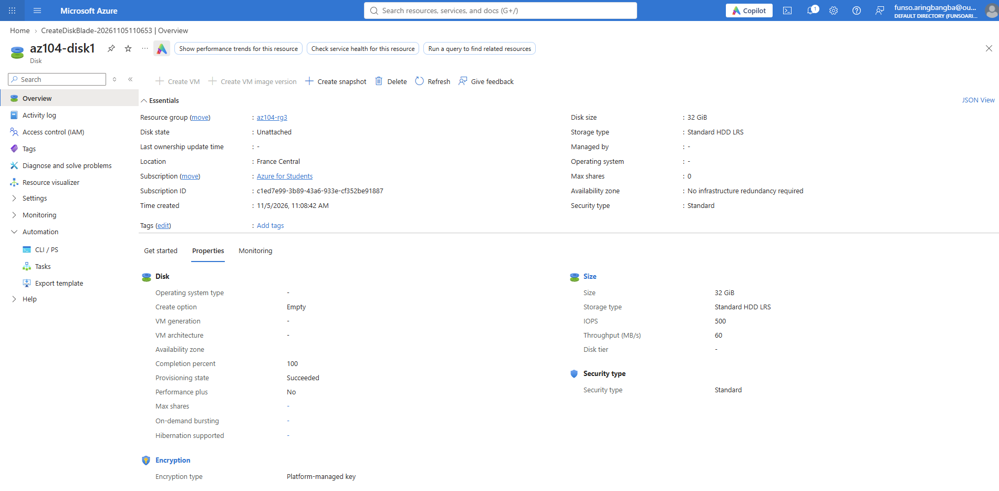
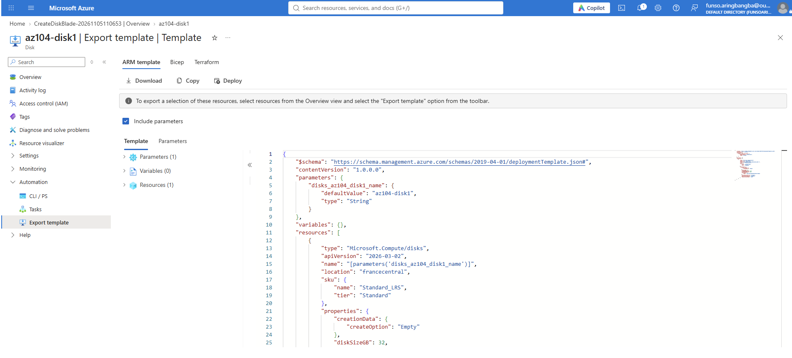

# Lab 03b: Manage Azure Resources by Using ARM Templates

**Date:** 
**Region used:** 
**Resource group:** az104-rg3

## Objective
## Task 1: Create a disk and export the template
## Task 2: Edit the template and redeploy (portal)
## Task 3: Deploy with Azure PowerShell
## Task 4: Deploy with Azure CLI
## Task 5: Deploy with Bicep
## Issues hit and how I fixed them
## Key takeaways
## Cleanup

## Task 1: Create a disk and export the template
Created a managed disk `az104-disk1` in `az104-rg3` (Standard HDD, 32 GiB, <your region>).
From Automation > Export template I downloaded `template.json` and `parameters.json`.
The template has `parameters` (the disk name), `resources` (the disk definition, SKU, size, location) and no outputs.
The export gives you a reusable copy of an existing resource without writing anything by hand.

