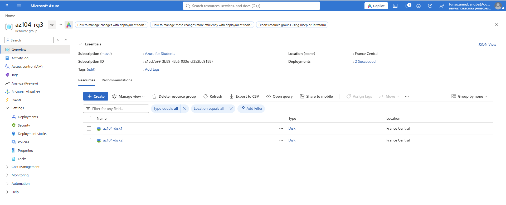
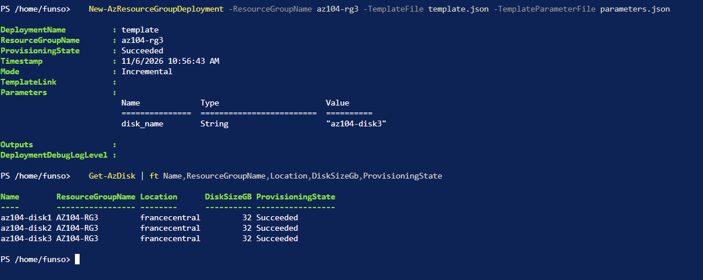
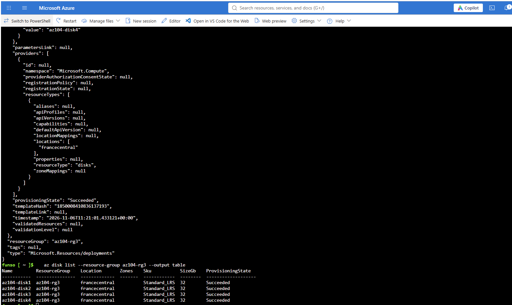
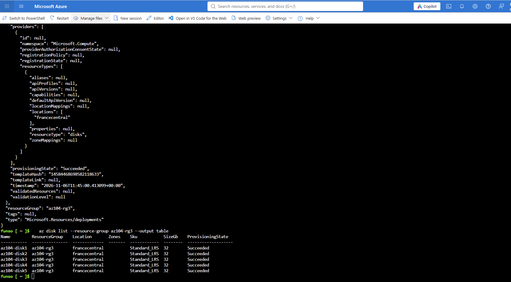

# Lab 03b: Manage Azure Resources by Using ARM Templates

**Date:** 5 Nov 2026
**Resource group:** az104-rg3
**Region:** <your region> (the lab uses East US, but my subscription only allows certain regions)

## What this lab is about
The goal is to stop clicking through the portal and deploy resources from a template instead. I deploy the same kind of managed disk five different ways: portal, custom template, PowerShell, CLI and Bicep. It's a small resource, but the point is that the process is repeatable.

## Task 1: Create a disk and export the template
I created a managed disk called `az104-disk1` in `az104-rg3` (Standard HDD, 32 GiB). Then I went to Automation > Export template and downloaded both files.

What I noticed:
- `template.json` holds the actual disk definition: type, SKU, size and location.
- `parameters.json` is much shorter. It only holds the disk name, and the value is `null` until you fill it in.

## Task 2: Edit the template and redeploy
I used Deploy a custom template and loaded my exported `template.json` into the editor. Changes I made:
- renamed the parameter `disks_az104_disk1_name` to `disk_name`, in the template and the parameters file
- changed the disk name to `az104-disk2`
- changed the location from `eastus` to `francecentral` to match my subscription

The deployment succeeded and `az104-rg3` now has two disks. I also checked Settings > Deployments and looked at the Input and Template tabs of a deployment. Every deployment is logged there, so it's worth checking the first few template-based deployments before reusing a template at scale.

### Where I got stuck
When I loaded my file into the template editor, I got "This is not a valid template" and the editor showed Resources (0). I'd downloaded the Parameters tab content by mistake and saved it as `template.json`. The export page has two tabs, Template and Parameters, and Download saves whichever one you're looking at.

How I fixed it: I went back to the export page, switched to the Template tab, downloaded again, and opened both files in Notepad before using them. The real template is long and has a `resources` array, and the parameters file is the short one.

Lesson: check what a file contains before you load it, not after the portal complains.

## Task 3: Deploy with Azure PowerShell
I opened Cloud Shell in PowerShell mode and uploaded `template.json` and `parameters.json` through Manage files. Then I deployed to the resource group:

`New-AzResourceGroupDeployment -ResourceGroupName az104-rg3 -TemplateFile template.json -TemplateParameterFile parameters.json`

It came back with ProvisioningState Succeeded, and `Get-AzDisk` listed `az104-disk3` next to the first two disks, all 32 GB in francecentral. The deployment mode was Incremental, which means it adds or updates what's in the template without deleting anything else in the resource group.

## Task 4: Deploy with Azure CLI
I switched Cloud Shell to Bash. My files were still there from Task 3, so I changed the disk name to `az104-disk4` in the editor and deployed:

`az deployment group create --resource-group az104-rg3 --template-file template.json --parameters parameters.json`

The output ended with `provisioningState: Succeeded`, and `az disk list --resource-group az104-rg3 --output table` showed four disks, all Standard_LRS, 32 GB, in francecentral.

Same template and same parameters file as PowerShell. Only the command changed. The CLI prints the whole deployment as JSON, which is much noisier than PowerShell's summary.

## Task 5: Deploy with Bicep
I uploaded `azuredeploydisk.bicep` to Cloud Shell and read through it before changing anything. Compared with the JSON template, it's a lot shorter and easier to read. I set the disk name to `az104-disk5` and the size to 32 GiB.

The lab also says to change the SKU to `StandardSSD_LRS`. I left it as `Standard_LRS` because my sandbox only allows that SKU.

Deployed with:
`az deployment group create --resource-group az104-rg3 --template-file azuredeploydisk.bicep`

`az disk list` then showed all five disks in `az104-rg3`.

## What I took away
- An exported template is a quick way to turn something I built by hand into something I can repeat.
- Same template and parameters file, three ways to deploy it (portal, PowerShell, CLI). The result is identical and only the tooling differs.
- Bicep does the same job as the JSON template with far less noise.
- The parameters file keeps values like the disk name out of the template, so one template can serve many deployments.
- Region and policy restrictions matter. Templates exported from one environment can need changes before they work in another.

## Cleanup
Deleted the `az104-rg3` resource group once the lab was finished to avoid leaving resources running.