# Lab 04: Implement Virtual Networking

**Date:**
**Resource group:** az104-rg4
**Region:** francecentral

## What this lab is about
I build two virtual networks with subnets (one in the portal, one from a template), lock down traffic with an NSG and an ASG, and set up public and private DNS zones.

## Task 1: Create CoreServicesVnet in the portal
I created `CoreServicesVnet` in `az104-rg4` (France Central) with the address space `10.20.0.0/16` and two subnets, deleting the default one:
- `SharedServicesSubnet` at `10.20.10.0/24`
- `DatabaseSubnet` at `10.20.20.0/24`

Each `/24` shows 251 available IPs, not 256, because Azure reserves five addresses in every subnet.

From Automation > Export template I downloaded the template and the parameters file (one from each tab). The template has three resources: the VNet and the two subnets, each defined separately.

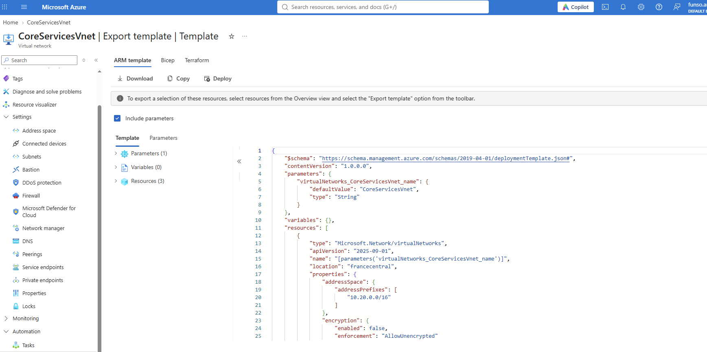
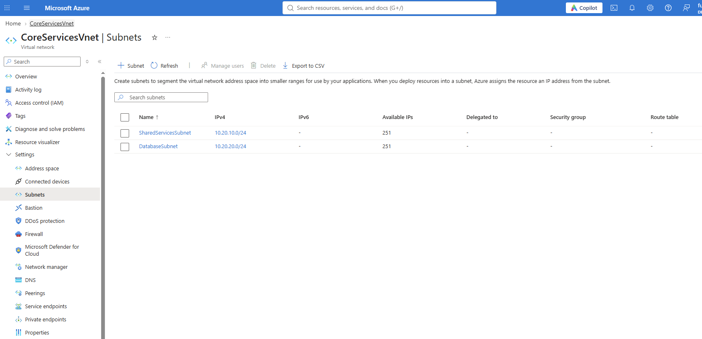

## Task 2: Create ManufacturingVnet from a template
I copied the exported CoreServicesVnet template and parameters files and edited them in a text editor with Find and Replace All:
- `CoreServicesVnet` to `ManufacturingVnet` (this also renamed the parameter)
- `10.20.0.0` to `10.30.0.0`
- `SharedServicesSubnet` to `SensorSubnet1`, and `10.20.10.0/24` to `10.30.20.0/24`
- `DatabaseSubnet` to `SensorSubnet2`, and `10.20.20.0/24` to `10.30.21.0/24`

In the parameters file I changed the one `CoreServicesVnet` to `ManufacturingVnet`. Then I deployed through Deploy a custom template into `az104-rg4`.

It worked first time. `ManufacturingVnet` is `10.30.0.0/16` with its two sensor subnets, and the exported template for the new VNet confirms the names and ranges. The two VNets (10.20.x.x and 10.30.x.x) don't overlap, which matters if you ever want to peer them.

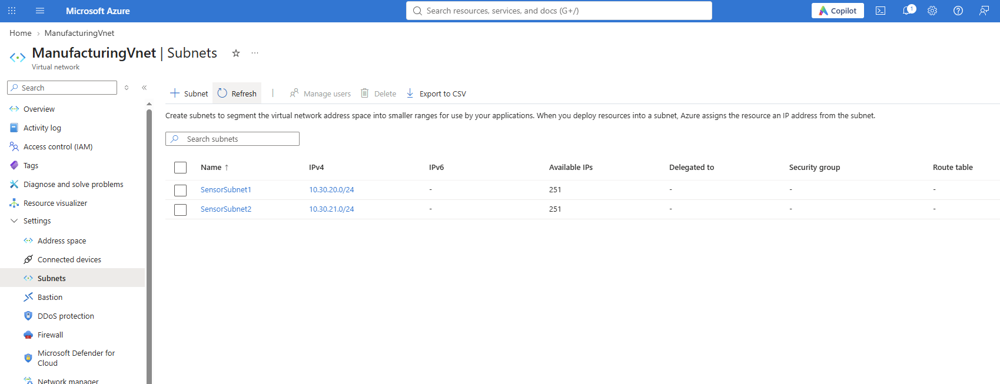
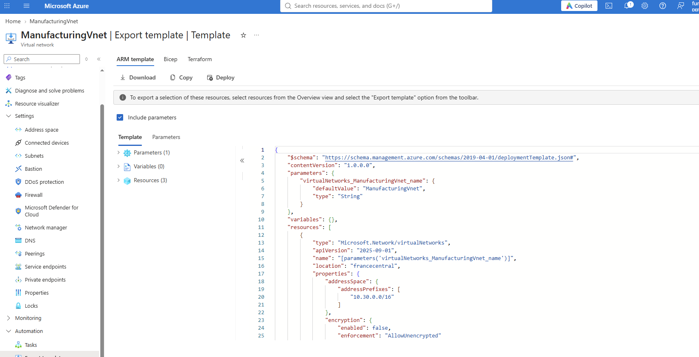

## Task 3: ASG and NSG
I created an application security group `asg-web` and a network security group `myNSGSecure`, both in France Central. The NSG has to be in the same region as the VNet, otherwise it can't be associated. I attached it to `SharedServicesSubnet` in `CoreServicesVnet`.

Two custom rules:
- **AllowASG** (inbound, priority 100): allows TCP 80 and 443 from `asg-web`. The default inbound rules only let in other virtual networks and load balancers, so without this rule nothing from `asg-web` would get through.
- **DenyInternetOutbound** (outbound, priority 4096): denies everything going to the Internet service tag.

The deny rule works even though there's a default `AllowInternetOutBound` rule, because rules are evaluated lowest priority number first. 4096 is checked before 65001, so the deny is matched first. The default rules can't be deleted, only overridden like this.

No VMs are attached to `asg-web`, so nothing is actually being filtered yet. In a real setup I'd put the web servers' NICs in that group.

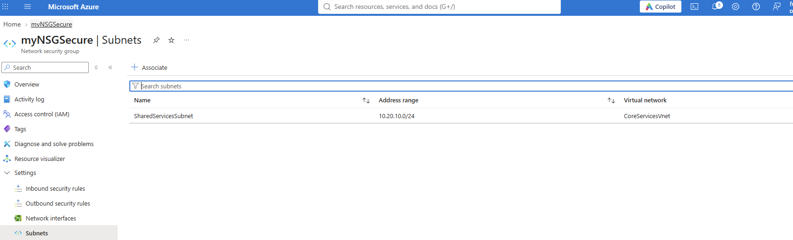
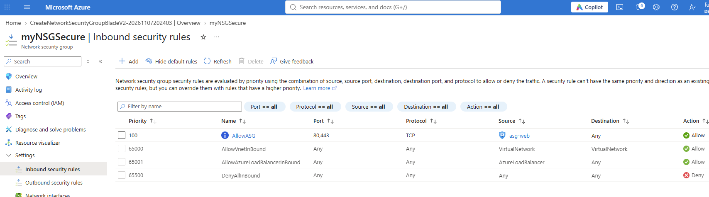
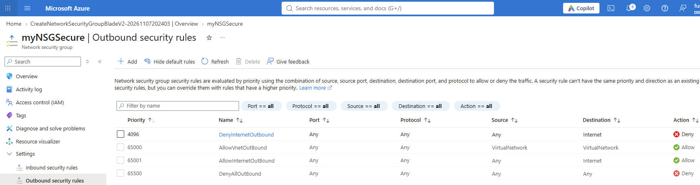

## Task 4: Public and private DNS zones
**Public zone.** I created `contosoxyz104.com` (a made-up name, since contoso.com is reserved and Azure doesn't check domain ownership) in `az104-rg4`. Azure assigned four name servers, and I added an A record `www` pointing to `10.1.1.4`. To test it I ran nslookup from Cloud Shell against one of the Azure name servers, and it returned `10.1.1.4`. In real life that would be the public IP of a web server.

**Private zone.** I created `private.contosoxyz104.com` and linked it to `ManufacturingVnet` with a virtual network link called `manufacturing-link` (auto-registration off). Then I added an A record `sensorvm` pointing to `10.1.1.4`.

The TTL shows 3600 on both records. The portal field has a unit dropdown, so the 1 I typed was 1 hour.

Difference between the two: a public zone has name servers and answers anyone on the internet. A private zone has no name servers and only answers from VNets that are linked to it, so I can't test it with nslookup from Cloud Shell. I'd need a VM inside `ManufacturingVnet`.

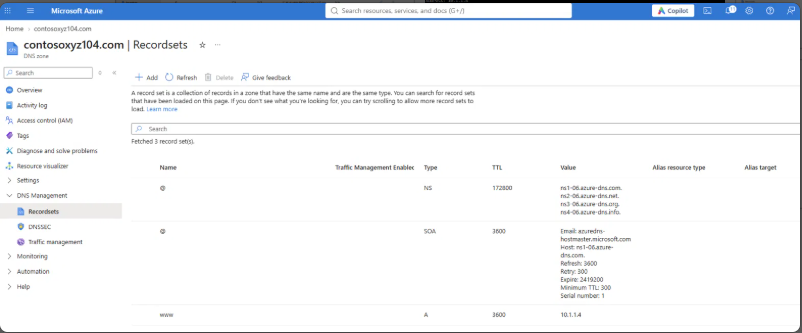
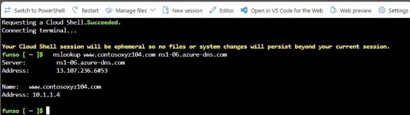
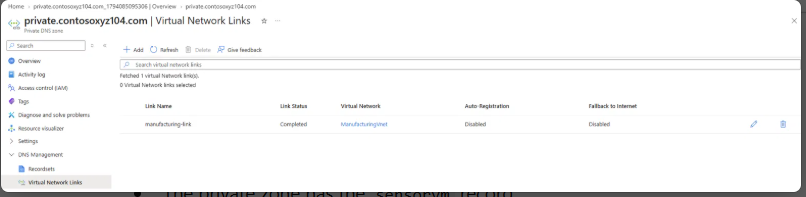
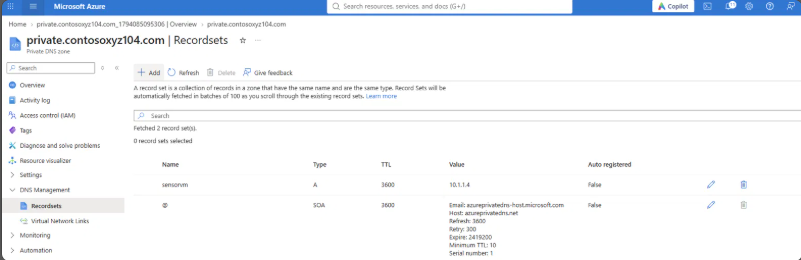
## What I took away
- Two VNets that use different ranges (10.20.0.0/16 and 10.30.0.0/16) can be peered later. Overlapping ranges can't.
- A /24 subnet gives 251 usable addresses, because Azure keeps five.
- Exporting a template and doing find and replace on it is a quick way to build a second, similar resource.
- NSG rules are evaluated lowest priority number first, so my deny at 4096 beats the default allow at 65001.
- An ASG lets me write rules against a group of servers instead of IP addresses.
- Public DNS answers the internet, private DNS only answers linked VNets.

## Cleanup
Deleted the `az104-rg4` resource group after the lab so the DNS zones stop costing money.