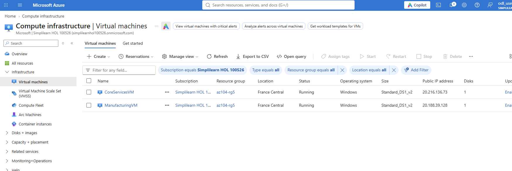
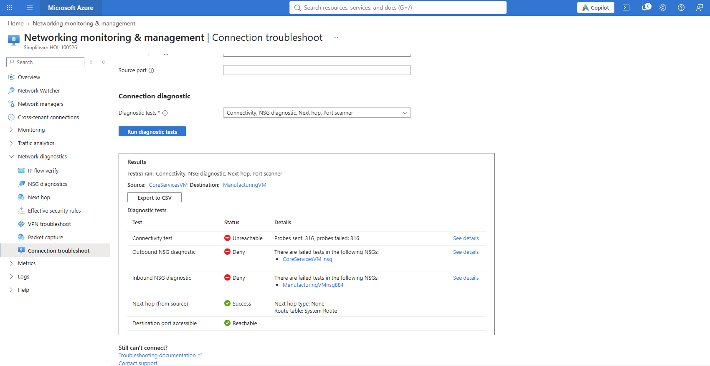
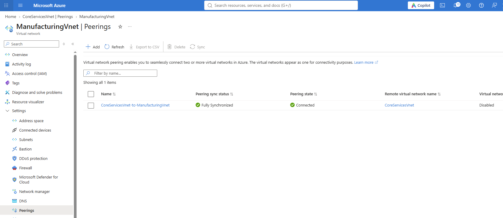
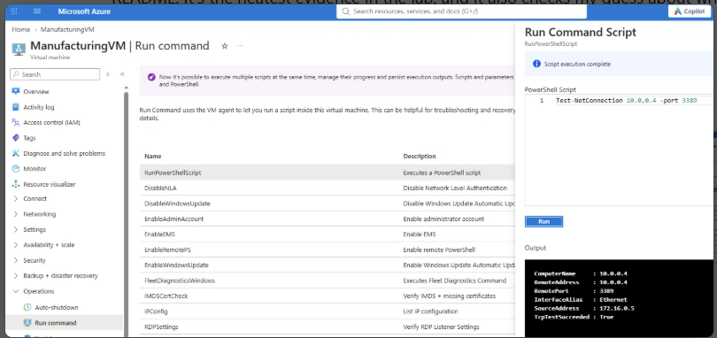
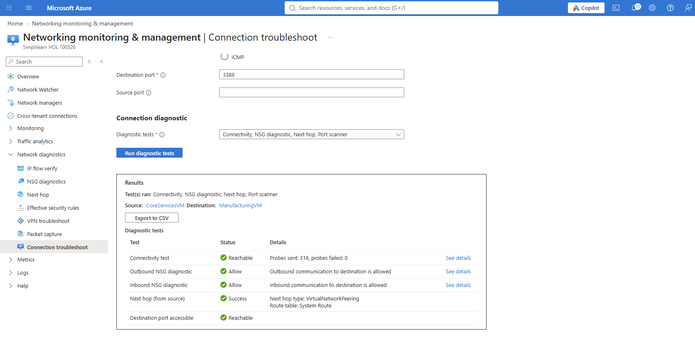

# Lab 05: Implement Intersite Connectivity

**Date:** 9 Nov 2026
**Resource group:** az104-rg5
**Region:** francecentral (the lab uses East US, but my subscription restricts regions)

## What this lab is about
By default, resources in different virtual networks can't talk to each other. In this lab I put one VM in each of two VNets, proved they couldn't connect, peered the networks, proved they could, and then built a custom route for a future network appliance.

## Task 1 and 2: The two VMs and their VNets
I created two Windows Server 2025 VMs in `az104-rg5`, each in its own VNet, with public inbound ports set to None:
- `CoreServicesVM` in `CoreServicesVnet` (10.0.0.0/16), subnet `Core` (10.0.0.0/24)
- `ManufacturingVM` in `ManufacturingVnet` (172.16.0.0/16), subnet `Manufacturing` (172.16.0.0/24)

Size is `Standard_DS1_v2`, not the lab's D2s_v5, because <what the sandbox allowed>. Boot diagnostics are disabled, as in the lab. The two address ranges don't overlap, which peering requires.

### Where I got stuck
The first `CoreServicesVM` deployment failed with `DeploymentFailed` / `ResourceDeploymentFailure`. That message is only the wrapper, and the real cause is under Deployments > Operation details. <what the status message said and what I changed to fix it>

## Task 3: Connection test before peering (Network Watcher)
I used Network Watcher > Connection troubleshoot, from `CoreServicesVM` to `ManufacturingVM` over TCP 3389.

Result: **Unreachable**, with 316 probes sent and all 316 failed. This was expected, because the VMs are in different VNets with no peering between them.

The diagnostics also showed why:
- Outbound NSG diagnostic: Deny, on `CoreServicesVM-nsg`
- Inbound NSG diagnostic: Deny, on `ManufacturingVMnsg884`
- Next hop: None, system route

I didn't write any of those rules. They're the default NSG rules. The default allow rules cover the `VirtualNetwork` tag, which doesn't include another VNet until it's peered, so the traffic hits the default deny.

## Task 4: VNet peering
I created the peering from `CoreServicesVnet` > Peerings > Add. The form creates both directions at once, one link on each VNet, with access and forwarded traffic enabled both ways. Both links show Connected and Fully Synchronized.

One thing I noticed afterwards: I put the link names on the wrong sides. The link on `ManufacturingVnet` is called `CoreServicesVnet-to-ManufacturingVnet` and the one on `CoreServicesVnet` is called `ManufacturingVnet-to-CoreServicesVnet`, the opposite of the usual convention. It's only a label, so connectivity isn't affected. Next time I'll read each section of the form carefully before typing the names.

Peering isn't transitive, and each direction needs its own link. The portal creates both when I add it from one side.

## Task 5: Connection test after peering (PowerShell)
First I opened the RDP port in Windows Firewall on `CoreServicesVM` with Run command:

`Enable-NetFirewallRule -DisplayGroup "Remote Desktop"`

Then from `ManufacturingVM` I ran:

`Test-NetConnection 10.0.0.4 -port 3389`

Result: `TcpTestSucceeded : True`, from 172.16.0.5 to 10.0.0.4.

I also reran the Network Watcher test from Task 3. Before peering it was Unreachable (316 of 316 probes failed, both NSG checks Deny, next hop None). After peering it's Reachable (0 of 316 failed, both NSG checks Allow, next hop VirtualNetworkPeering).

I didn't change any NSG rules between the two runs. Peering alone fixed it: the default allow rules cover the `VirtualNetwork` tag, and once the VNets are peered that tag includes the other VNet.

## Task 6: Custom route
I added a `perimeter` subnet (10.0.1.0/24) to `CoreServicesVnet` and created a route table `rt-CoreServices` in France Central. In it I added a route:
- Name: `PerimetertoCore`
- Destination: `10.0.0.0/16` (the core VNet)
- Next hop type: Virtual appliance
- Next hop address: `10.0.1.7` (a future network appliance)

Then I associated the route table with the `perimeter` subnet only.

There's no actual appliance at 10.0.1.7, so no traffic goes through it yet. The point is to see how a user-defined route works: it overrides the default system routes for any subnet it's attached to. I attached it only to `perimeter`, so the `Core` subnet keeps its normal routing.

## What I took away
- Resources in different VNets can't communicate until the VNets are peered.
- Peered VNets behave as one network for connectivity, and traffic stays on the Microsoft backbone.
- Peering has to exist in both directions. The portal creates both when I add it from one side.
- The default NSG rules allow the `VirtualNetwork` tag, and peering extends that tag to the other VNet. That's why I didn't need any new NSG rules.
- Network Watcher's connection troubleshoot gives more than yes or no. It shows which NSG blocked the traffic and what the next hop is.
- System routes exist by default for every subnet, and a user-defined route overrides them where I attach it.
- Windows Firewall inside the VM is a separate layer from the NSG. I had to enable the RDP rule before the test could succeed.

## Cleanup
Deleted `az104-rg5` after the lab, because the VMs are the part that costs money.