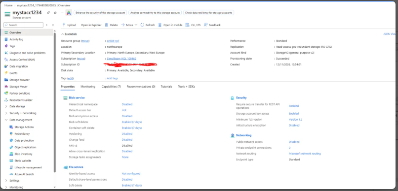
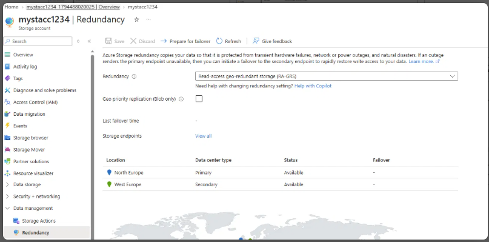
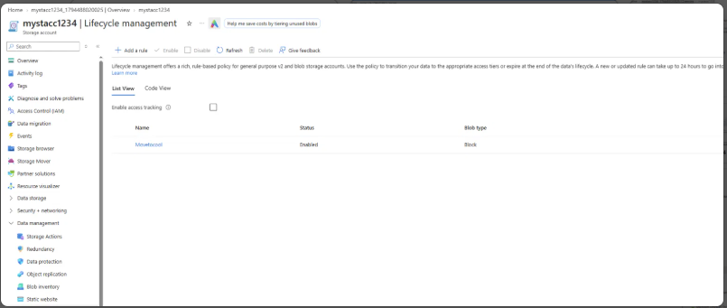
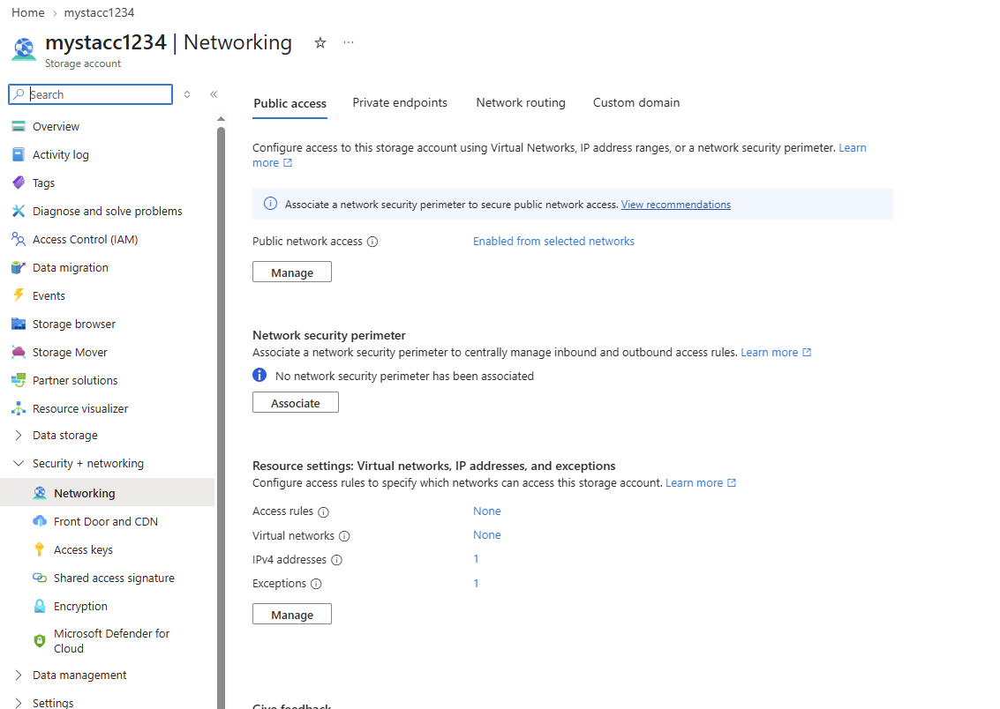
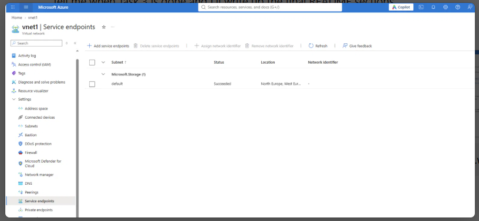
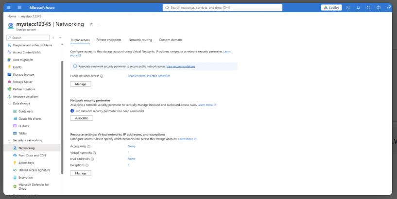
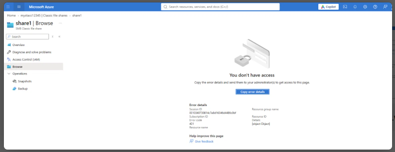

# Lab 07: Manage Azure Storage

**Date:** 12 Nov 2026
**Resource group:** az104-rg7
**Region:** northeurope (the lab uses East US, but I'm in Ireland so I used North Europe)

## What this lab is about
This lab is about the security layers around a storage account: redundancy, who can reach it over the network, who is allowed to read the data, and how to hand someone temporary access. I create one storage account and use it for blobs and files, and at the end I lock it down so only my own virtual network can get in.

## Task 1: Create and configure a storage account
I created a storage account in `az104-rg7`, North Europe, Standard performance, with geo-redundant storage and read access to the secondary region switched on (RA-GRS). The Redundancy blade shows North Europe as primary and West Europe as secondary, both available. This is the point of GRS: data is copied to the paired region, and I can still read it if the primary region goes down.

At creation I set public network access to Disabled. Afterwards I changed it to Enabled from selected networks and added my own IP address, so I could still reach the account from the portal while the rest of the internet was blocked.

I also added a lifecycle rule called `Movetocool` that moves base blobs to the cool tier when they haven't been modified for 30 days. It's a cheap way to cut storage cost for files nobody touches.

[Note: the Task 1 screenshots show `mystacc1234` and the later tasks use `mystacc12345`. <explain why there are two, or delete this line if it was only one account>]

## Task 2: Secure blob storage
I created a private container called `data` and put a time-based retention policy of 180 days on it. I left the policy unlocked, because locking is permanent. Then I uploaded a small file into a folder called `securitytest` (block blob, 4 MiB block size, Hot tier).

Opening the blob's plain URL in an InPrivate window gave an XML error, because the container is private with no anonymous access. That's what I expected.

Then I generated a SAS with a user delegation key, read-only permission, valid from yesterday to tomorrow. Opening the SAS URL in a new InPrivate window displayed the file's contents.

| Method | Result |
|---|---|
| Plain blob URL | Blocked, the container is private |
| SAS URL | Works, with a time-limited, read-only token |

### Where I got stuck
<The SAS link first returned `AuthorizationPermissionMismatch`. A user delegation SAS can only grant what my own identity is allowed to do on the data, and being subscription Owner doesn't include blob data permissions. I assigned myself Storage Blob Data Contributor, waited for it to take effect, and generated a fresh SAS. Edit this to match what you actually did.>

Lesson: management roles (Owner, Contributor) are separate from data roles (Storage Blob Data ...). I needed both.

## Task 3: Secure Azure file storage
I created a classic file share called `share1` (Transaction optimized tier, backup off), then used Storage Browser to add a folder and upload a file.

Then I locked the account down to a virtual network:
- I created `vnet1` in North Europe, in the same region as the storage account.
- I added a Microsoft.Storage service endpoint on its `default` subnet. This lets that subnet reach storage over Microsoft's backbone, and storage can then identify it as an allowed source.
- In the storage account's Networking blade I added `vnet1` / `default` as an allowed network, and deleted my own IP address.

After that, opening `share1` from the portal returned **"You don't have access"** with error code 401. That's the successful result. My machine isn't in `vnet1`, so the storage firewall now refuses it. The account is only reachable from that virtual network.

The Networking blade now reads: enabled from selected networks, one virtual network, no IPv4 addresses.

## What I took away
- Storage accounts have several independent layers: redundancy, network firewall, authentication, authorisation and encryption. A request has to pass all of them.
- GRS copies data to the paired region, and the RA option lets me read from it if the primary region is down.
- A SAS gives time-limited, scoped access without sharing account keys. A user delegation SAS is signed with my identity, so it depends on my data permissions.
- Owner is not a data role. Blob and file access needs its own role assignments.
- Service endpoints plus the storage firewall limit access to a specific virtual network, and the 401 I got from my own machine is that rule working.
- Immutable (WORM) retention policies stop blobs being changed or deleted. Locking one is permanent, so leave it unlocked while learning.

## Cleanup
Deleted the `az104-rg7` resource group, which removes the storage account(s) and `vnet1`. The firewall doesn't block this, because deleting a resource group is a management action and not a data request.